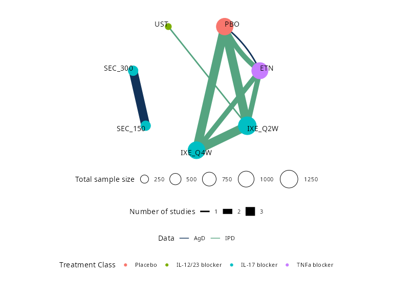
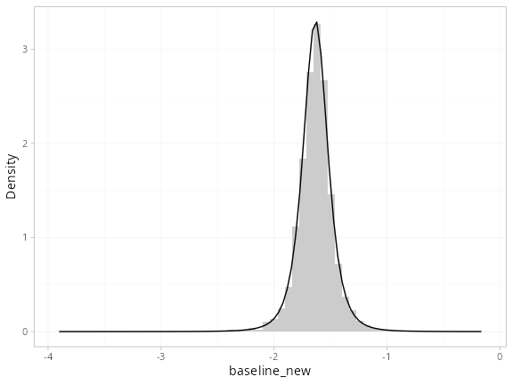
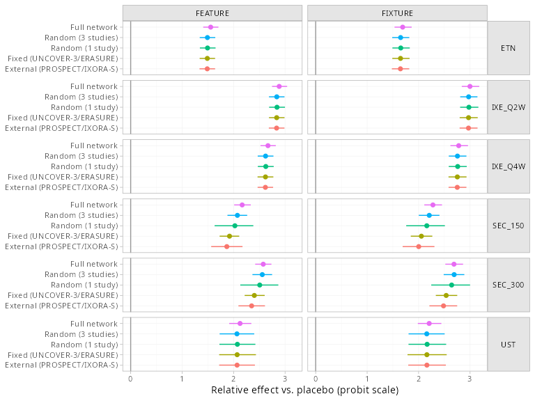
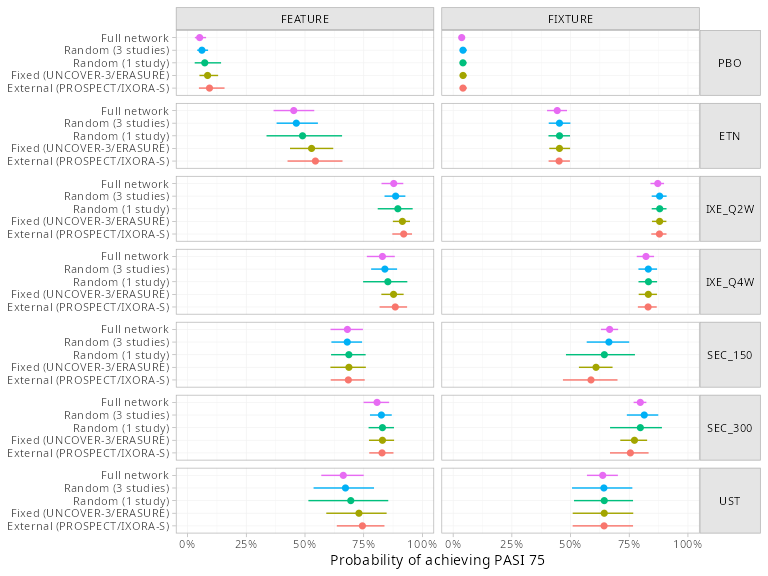

``` r
library(multinma)
#> For execution on a local, multicore CPU with excess RAM we recommend calling
#> options(mc.cores = parallel::detectCores())
#> 
#> Attaching package: 'multinma'
#> The following objects are masked from 'package:stats':
#> 
#>     dgamma, pgamma, qgamma
library(dplyr)      # dplyr for data manipulation
#> 
#> Attaching package: 'dplyr'
#> The following objects are masked from 'package:stats':
#> 
#>     filter, lag
#> The following objects are masked from 'package:base':
#> 
#>     intersect, setdiff, setequal, union
library(ggplot2)    # ggplot2 for plotting
```

``` r
options(mc.cores = parallel::detectCores())
```


<!-- TODO (Sam): add a citation for the ML-NMR-B paper once it has a reference -->

This vignette demonstrates how to analyse a disconnected network with multilevel network meta-regression (ML-NMR), using random and fixed baseline bridges.
We use the plaque psoriasis network of @Phillippo2022 (see `vignette("example_plaque_psoriasis")`), and deliberately disconnect it by removing arms, so that the results from each bridging method can be compared with those from the full connected network.

# Setup
## Preparing the data
We transform the covariates in the IPD and AgD as in `vignette("example_plaque_psoriasis")`, additionally including age, sex, and baseline PASI score.

``` r
# IPD studies
pso_ipd <- plaque_psoriasis_ipd %>%
  mutate(
    # Variable transformations
    bsa = bsa / 100,
    weight = weight / 10,
    durnpso = durnpso / 10,
    prevsys = as.numeric(prevsys),
    psa = as.numeric(psa),
    male = as.numeric(male),
    age = age / 10,
    pasi_w0 = pasi_w0 / 10,
    # Treatment classes
    trtclass = case_when(trtn == 1 ~ "Placebo",
                         trtn %in% c(2, 3, 5, 6) ~ "IL-17 blocker",
                         trtn == 4 ~ "TNFa blocker",
                         trtn == 7 ~ "IL-12/23 blocker"),
    # Check complete cases for covariates of interest
    is_complete = complete.cases(durnpso, prevsys, bsa, weight, psa)
  ) %>%
  filter(is_complete) %>%
  arrange(studyc, trtn)

# AgD studies
pso_agd <- plaque_psoriasis_agd %>%
  mutate(
    # Variable transformations
    bsa_mean = bsa_mean / 100,
    bsa_sd = bsa_sd / 100,
    weight_mean = weight_mean / 10,
    weight_sd = weight_sd / 10,
    durnpso_mean = durnpso_mean / 10,
    durnpso_sd = durnpso_sd / 10,
    prevsys = prevsys / 100,
    psa = psa / 100,
    male = male / 100,
    age_mean = age_mean / 10,
    age_sd = age_sd / 10,
    pasi_w0_mean = pasi_w0_mean / 10,
    pasi_w0_sd = pasi_w0_sd / 10,
    # Treatment classes
    trtclass = case_when(trtn == 1 ~ "Placebo",
                         trtn %in% c(2, 3, 5, 6) ~ "IL-17 blocker",
                         trtn == 4 ~ "TNFa blocker",
                         trtn == 7 ~ "IL-12/23 blocker")
  ) %>%
  arrange(studyc, trtn)
```

To disconnect the network, we remove the placebo arms of ERASURE, FEATURE, and JUNCTURE, the secukinumab arms of FIXTURE, and the CLEAR study.

``` r
pso_agd_disc <- pso_agd %>%
  filter(studyc != "CLEAR",
         !(studyc %in% c("ERASURE", "FEATURE", "JUNCTURE") & trtc == "PBO"),
         !(studyc == "FIXTURE" & trtc %in% c("SEC_150", "SEC_300")))
```

For one of our fixed baseline bridges, we use the PROSPECT cohort study [@Thaci2019], a single-arm study of secukinumab 300 mg.

``` r
pso_agd_prospect <- tibble(
  studyc = "PROSPECT", trtc_long = "Secukinumab 300 mg", trtc = "SEC_300", trtn = 6,
  trtclass = "IL-17 blocker",
  pasi75_r = 1156, pasi75_n = 1509,
  pasi90_r = 801, pasi90_n = 1509,
  pasi100_r = 337, pasi100_n = 1509,
  bsa_mean = 0.187, bsa_sd = 0.184,
  weight_mean = 8.75, weight_sd = 2.03,
  durnpso_mean = 1.96, durnpso_sd = 1.35,
  prevsys = 0.9095,
  psa = 0.202,
  age_mean = 4.81, age_sd = 1.37,
  male = 0.624,
  pasi_w0_mean = 1.77, pasi_w0_sd = 1.25
)
```

## Creating the networks
We create three networks: the full connected network, the disconnected network, and the disconnected network with PROSPECT added.

``` r
pso_net <- combine_network(
  set_ipd(pso_ipd,
          study = studyc,
          trt = trtc,
          r = multi(r0 = 1, PASI75 = pasi75, PASI90 = pasi90, PASI100 = pasi100,
                    type = "ordered", inclusive = TRUE),
          trt_class = trtclass),
  set_agd_arm(pso_agd,
              study = studyc,
              trt = trtc,
              r = multi(r0 = pasi75_n, PASI75 = pasi75_r, PASI90 = pasi90_r, PASI100 = pasi100_r,
                        type = "ordered", inclusive = TRUE),
              trt_class = trtclass),
  trt_ref = "PBO"
)

pso_net_disc <- combine_network(
  set_ipd(pso_ipd,
          study = studyc,
          trt = trtc,
          r = multi(r0 = 1, PASI75 = pasi75, PASI90 = pasi90, PASI100 = pasi100,
                    type = "ordered", inclusive = TRUE),
          trt_class = trtclass),
  set_agd_arm(pso_agd_disc,
              study = studyc,
              trt = trtc,
              r = multi(r0 = pasi75_n, PASI75 = pasi75_r, PASI90 = pasi90_r, PASI100 = pasi100_r,
                        type = "ordered", inclusive = TRUE),
              trt_class = trtclass),
  trt_ref = "PBO"
)

pso_net_ext <- combine_network(
  set_ipd(pso_ipd,
          study = studyc,
          trt = trtc,
          r = multi(r0 = 1, PASI75 = pasi75, PASI90 = pasi90, PASI100 = pasi100,
                    type = "ordered", inclusive = TRUE),
          trt_class = trtclass),
  set_agd_arm(bind_rows(pso_agd_disc, pso_agd_prospect),
              study = studyc,
              trt = trtc,
              r = multi(r0 = pasi75_n, PASI75 = pasi75_r, PASI90 = pasi90_r, PASI100 = pasi100_r,
                        type = "ordered", inclusive = TRUE),
              trt_class = trtclass),
  trt_ref = "PBO"
)
#> Warning: Single-arm study present in the network: "PROSPECT".
```

The disconnected network has two sub-networks: secukinumab is only compared within ERASURE, FEATURE, and JUNCTURE.

``` r
pso_net_disc
#> A network with 4 IPD studies, and 4 AgD studies (arm-based).
#> 
#> ------------------------------------------------------------------- IPD studies ---- 
#>  Study     Treatment arms                  
#>  IXORA-S   2: IXE_Q2W | UST                
#>  UNCOVER-1 3: PBO | IXE_Q2W | IXE_Q4W      
#>  UNCOVER-2 4: PBO | IXE_Q2W | IXE_Q4W | ETN
#>  UNCOVER-3 4: PBO | IXE_Q2W | IXE_Q4W | ETN
#> 
#>  Outcome type: ordered (4 categories)
#> ------------------------------------------------------- AgD studies (arm-based) ---- 
#>  Study    Treatment arms      
#>  ERASURE  2: SEC_150 | SEC_300
#>  FEATURE  2: SEC_150 | SEC_300
#>  FIXTURE  2: PBO | ETN        
#>  JUNCTURE 2: SEC_150 | SEC_300
#> 
#>  Outcome type: ordered (4 categories)
#> ------------------------------------------------------------------------------------
#> Total number of treatments: 7, in 4 classes
#> Total number of studies: 8
#> Reference treatment is: PBO
#> Network is disconnected
plot(pso_net_disc, weight_nodes = TRUE, weight_edges = TRUE, show_trt_class = TRUE) +
  ggplot2::theme(legend.position = "bottom", legend.box = "vertical")
```



## Numerical integration for ML-NMR
We add integration points to each network as in `vignette("example_plaque_psoriasis")`.

``` r
pso_net <- add_integration(pso_net,
  durnpso = distr(qgamma, mean = durnpso_mean, sd = durnpso_sd),
  prevsys = distr(qbern, prob = prevsys),
  bsa = distr(qlogitnorm, mean = bsa_mean, sd = bsa_sd),
  weight = distr(qgamma, mean = weight_mean, sd = weight_sd),
  psa = distr(qbern, prob = psa),
  age = distr(qgamma, mean = age_mean, sd = age_sd),
  male = distr(qbern, prob = male),
  pasi_w0 = distr(qgamma, mean = pasi_w0_mean, sd = pasi_w0_sd),
  n_int = 64)
#> Using weighted average correlation matrix computed from IPD studies.

pso_net_disc <- add_integration(pso_net_disc,
  durnpso = distr(qgamma, mean = durnpso_mean, sd = durnpso_sd),
  prevsys = distr(qbern, prob = prevsys),
  bsa = distr(qlogitnorm, mean = bsa_mean, sd = bsa_sd),
  weight = distr(qgamma, mean = weight_mean, sd = weight_sd),
  psa = distr(qbern, prob = psa),
  age = distr(qgamma, mean = age_mean, sd = age_sd),
  male = distr(qbern, prob = male),
  pasi_w0 = distr(qgamma, mean = pasi_w0_mean, sd = pasi_w0_sd),
  n_int = 64)
#> Using weighted average correlation matrix computed from IPD studies.

pso_net_ext <- add_integration(pso_net_ext,
  durnpso = distr(qgamma, mean = durnpso_mean, sd = durnpso_sd),
  prevsys = distr(qbern, prob = prevsys),
  bsa = distr(qlogitnorm, mean = bsa_mean, sd = bsa_sd),
  weight = distr(qgamma, mean = weight_mean, sd = weight_sd),
  psa = distr(qbern, prob = psa),
  age = distr(qgamma, mean = age_mean, sd = age_sd),
  male = distr(qbern, prob = male),
  pasi_w0 = distr(qgamma, mean = pasi_w0_mean, sd = pasi_w0_sd),
  n_int = 64)
#> Using weighted average correlation matrix computed from IPD studies.
```

# Assessing population overlap
Bridging assumes that, after adjusting for the observed covariates, absolute outcomes are exchangeable between the bridged study populations (conditional constancy of absolute effects).
We compare the populations of studies in different sub-networks with `compare_populations()`, which reports the overlap effective sample size (ESS%) from a propensity score model; higher values indicate more similar populations.

``` r
pso_overlap <- compare_populations(pso_net_ext,
                                   covariates = c("durnpso", "prevsys", "bsa", "weight", "psa",
                                                  "age", "male", "pasi_w0"),
                                   method = "propensity")
pso_overlap
#> Compared populations using propensity score overlap, based on the following covariates: durnpso, prevsys, bsa, weight, psa, age, male and pasi_w0.
#> 
#> ------------------------ Pairwise comparisons in decreasing order of similarity ---- 
#>                         original_n     ess ess_percent
#>   ERASURE vs. UNCOVER-3       1827 1779.83       97.42
#>  JUNCTURE vs. UNCOVER-2       1339 1302.26       97.26
#>   FEATURE vs. UNCOVER-2       1337 1294.10       96.79
#>  JUNCTURE vs. UNCOVER-3       1459 1411.28       96.73
#>     ERASURE vs. FIXTURE       1135 1095.62       96.53
#>  JUNCTURE vs. UNCOVER-1       1416 1360.72       96.10
#>   ERASURE vs. UNCOVER-2       1707 1629.96       95.49
#>   FEATURE vs. UNCOVER-1       1414 1350.14       95.48
#>   FEATURE vs. UNCOVER-3       1457 1384.23       95.01
#>   ERASURE vs. UNCOVER-1       1784 1689.04       94.68
#>  ... plus 10 more comparisons
#> 
#> ------------------------------------------------ Matrix of pairwise comparisons ---- 
#> Subnetwork 2 vs. 1:
#>           ERASURE FEATURE JUNCTURE PROSPECT
#> FIXTURE     96.53   88.44    85.48    75.46
#> IXORA-S     86.38   87.02    74.01    88.77
#> UNCOVER-1   94.68   95.48    96.10    86.46
#> UNCOVER-2   95.49   96.79    97.26    84.47
#> UNCOVER-3   97.42   95.01    96.73    80.60
```

UNCOVER-3 and ERASURE are the most similar pair (97.42%), and JUNCTURE and IXORA-S the least similar (74.01%).
PROSPECT is most similar to IXORA-S.

# Full network ML-NMR
For comparison, we first fit the ML-NMR model to the full connected network.

``` r
pso_fit_full <- nma(pso_net,
                    trt_effects = "fixed",
                    link = "probit",
                    regression = ~(durnpso + prevsys + bsa + weight + psa)*.trt + pasi_w0 + age + male,
                    class_interactions = "common",
                    prior_intercept = normal(scale = 10),
                    prior_trt = normal(scale = 10),
                    prior_reg = normal(scale = 10),
                    prior_aux = flat(),
                    QR = TRUE,
                    init_r = 0.2)
```

# Random baseline bridge
## Stage 1: Baseline synthesis
We fit a baseline synthesis model with `baseline_synthesis()`, placing a random effect on the study baselines (on placebo) in the reference sub-network.

``` r
pso_fit_bs <- baseline_synthesis(pso_net_disc,
                                 trt_effects = "fixed",
                                 link = "probit",
                                 regression = ~(durnpso + prevsys + bsa + weight + psa)*.trt + pasi_w0 + age + male,
                                 class_interactions = "common",
                                 prior_intercept = normal(scale = 10),
                                 prior_intercept_sd = half_normal(scale = 5),
                                 prior_trt = normal(scale = 10),
                                 prior_reg = normal(scale = 10),
                                 prior_aux = flat(),
                                 QR = FALSE,
                                 init_r = 0.2)
```

Note that we do not use the QR decomposition (`QR = FALSE`) here, unlike for the fixed and external bridges and the full network.
The QR decomposition reparameterises the regression to make sampling easier, but it does not work well with a random effect on the study baselines, and sampling can be very slow.
We therefore turn it off for both stages of the random baseline bridge, including the Stage 2 models with `connect_baseline` below.
With `QR = FALSE`, sampling is more efficient when the covariates are approximately unit scale, which is why we rescaled them earlier (for example, dividing weight by 10), and when they are centred, which is the default (`center = TRUE`).

The posterior summaries give the mean study baseline (`baseline_mean`), the between-study standard deviation (`baseline_sd`), and the predictive distribution for the baseline in a new study (`baseline_new`), all on the probit scale.

``` r
summary(pso_fit_bs, pars = c("baseline_new", "baseline_mean", "baseline_sd"))
#>                mean   sd  2.5%   25%   50%   75% 97.5% Bulk_ESS Tail_ESS Rhat
#> baseline_new  -1.64 0.17 -1.96 -1.72 -1.63 -1.55 -1.31     3196     3142    1
#> baseline_mean -1.63 0.09 -1.81 -1.69 -1.63 -1.58 -1.46     2296     2223    1
#> baseline_sd    0.12 0.08  0.02  0.07  0.10  0.14  0.32     1353     1443    1
```

The predictive distribution has heavier tails than a normal distribution, since it also includes the uncertainty in `baseline_mean` and `baseline_sd`.
`baseline_synthesis()` therefore approximates it by a Student t distribution, stored as `baseline_prior`:

``` r
pso_fit_bs$baseline_prior
#> A Student t prior distribution: location = -1.63344635624909, scale = 0.11279782138027, df = 3.74205168367888.
```


``` r
pso_bl_new <- as.data.frame(pso_fit_bs, pars = "baseline_new")
pso_bl_prior <- pso_fit_bs$baseline_prior

ggplot(pso_bl_new, aes(x = baseline_new)) +
  geom_histogram(aes(y = after_stat(density)), bins = 60, fill = "grey80") +
  geom_function(inherit.aes = FALSE,
                fun = function(x) dt((x - pso_bl_prior$location) / pso_bl_prior$scale,
                                     df = pso_bl_prior$df) / pso_bl_prior$scale) +
  labs(x = "baseline_new", y = "Density") +
  theme_multinma()
```



## Stage 2: ML-NMR with predictive prior distributions
We fit an ML-NMR model to the disconnected network, using `connect_baseline` and `con(type = "random")` to place the predictive prior on the baselines of the disconnected studies.
First we apply this to all three disconnected studies:

``` r
pso_fit_random_3 <- nma(pso_net_disc,
                        trt_effects = "fixed",
                        link = "probit",
                        regression = ~(durnpso + prevsys + bsa + weight + psa)*.trt + pasi_w0 + age + male,
                        class_interactions = "common",
                        connect_baseline = con(type = "random",
                                               studies = c("ERASURE", "FEATURE", "JUNCTURE"),
                                               prior_baseline = pso_fit_bs$baseline_prior),
                        prior_intercept = normal(scale = 10),
                        prior_trt = normal(scale = 10),
                        prior_reg = normal(scale = 10),
                        prior_aux = flat(),
                        QR = FALSE,
                        init_r = 0.2)
```

Then to ERASURE only, the study with greatest overlap with the reference sub-network:

``` r
pso_fit_random_1 <- nma(pso_net_disc,
                        trt_effects = "fixed",
                        link = "probit",
                        regression = ~(durnpso + prevsys + bsa + weight + psa)*.trt + pasi_w0 + age + male,
                        class_interactions = "common",
                        connect_baseline = con(type = "random",
                                               studies = "ERASURE",
                                               prior_baseline = pso_fit_bs$baseline_prior),
                        prior_intercept = normal(scale = 10),
                        prior_trt = normal(scale = 10),
                        prior_reg = normal(scale = 10),
                        prior_aux = flat(),
                        QR = FALSE,
                        init_r = 0.2)
```

# Fixed baseline bridge
A fixed baseline bridge assumes that the adjusted baselines of two studies, one from each sub-network, are identical.
We bridge UNCOVER-3 and ERASURE, the pair with greatest overlap, using `con(type = "fixed")`.

``` r
pso_fit_fixed <- nma(pso_net_disc,
                     trt_effects = "fixed",
                     link = "probit",
                     regression = ~(durnpso + prevsys + bsa + weight + psa)*.trt + pasi_w0 + age + male,
                     class_interactions = "common",
                     connect_baseline = con(type = "fixed",
                                            studies = c("UNCOVER-3", "ERASURE")),
                     prior_intercept = normal(scale = 10),
                     prior_trt = normal(scale = 10),
                     prior_reg = normal(scale = 10),
                     prior_aux = flat(),
                     QR = TRUE,
                     init_r = 0.2)
```

# External bridge
An external bridge is a fixed baseline bridge with a study from outside the network.
We bridge PROSPECT to IXORA-S, the study it is most similar to.

``` r
pso_fit_ext <- nma(pso_net_ext,
                   trt_effects = "fixed",
                   link = "probit",
                   regression = ~(durnpso + prevsys + bsa + weight + psa)*.trt + pasi_w0 + age + male,
                   class_interactions = "common",
                   connect_baseline = con(type = "fixed",
                                          studies = c("PROSPECT", "IXORA-S")),
                   prior_intercept = normal(scale = 10),
                   prior_trt = normal(scale = 10),
                   prior_reg = normal(scale = 10),
                   prior_aux = flat(),
                   QR = TRUE,
                   init_r = 0.2)
```

# Comparing the bridging methods
We compare the relative effects against placebo in the FEATURE and FIXTURE populations from each bridging method with those from the full network.

``` r
pso_releff <- bind_rows(
  "Full network" = as_tibble(relative_effects(pso_fit_full)),
  "Random (3 studies)" = as_tibble(relative_effects(pso_fit_random_3)),
  "Random (1 study)" = as_tibble(relative_effects(pso_fit_random_1)),
  "Fixed (UNCOVER-3/ERASURE)" = as_tibble(relative_effects(pso_fit_fixed)),
  "External (PROSPECT/IXORA-S)" = as_tibble(relative_effects(pso_fit_ext)),
  .id = "Bridge") %>%
  filter(.study %in% c("FEATURE", "FIXTURE")) %>%
  mutate(Bridge = forcats::fct_rev(forcats::fct_inorder(Bridge)))

ggplot(pso_releff, aes(x = mean, xmin = `2.5%`, xmax = `97.5%`, y = Bridge, colour = Bridge)) +
  geom_vline(xintercept = 0, colour = "grey60") +
  geom_pointrange(size = 0.3) +
  facet_grid(.trtb ~ .study) +
  labs(x = "Relative effect vs. placebo (probit scale)", y = NULL) +
  theme_multinma() +
  theme(legend.position = "none", strip.text.y = element_text(angle = 0))
```



The relative effects of etanercept, ixekizumab, and ustekinumab do not depend on the bridge.
For secukinumab, the random baseline bridge applied to all three disconnected studies is closest to the full network; applying it to a single study gives wider credible intervals.
The fixed and external bridges give estimates further from the full network, despite high observed overlap, suggesting unobserved differences between the bridged studies.

The relative effects are on the probit scale, which can be hard to interpret.
We can also compare the predicted probabilities of achieving PASI 75 on each treatment in the FEATURE and FIXTURE populations, using `predict()` with `type = "response"`.
See `vignette("example_plaque_psoriasis")` for further prediction options, such as predicting into external target populations.

``` r
pso_pasi75 <- bind_rows(
  "Full network" = as_tibble(predict(pso_fit_full, type = "response")),
  "Random (3 studies)" = as_tibble(predict(pso_fit_random_3, type = "response")),
  "Random (1 study)" = as_tibble(predict(pso_fit_random_1, type = "response")),
  "Fixed (UNCOVER-3/ERASURE)" = as_tibble(predict(pso_fit_fixed, type = "response")),
  "External (PROSPECT/IXORA-S)" = as_tibble(predict(pso_fit_ext, type = "response")),
  .id = "Bridge") %>%
  filter(.study %in% c("FEATURE", "FIXTURE"), .category == "PASI75") %>%
  mutate(Bridge = forcats::fct_rev(forcats::fct_inorder(Bridge)))

ggplot(pso_pasi75, aes(x = mean, xmin = `2.5%`, xmax = `97.5%`, y = Bridge, colour = Bridge)) +
  geom_pointrange(size = 0.3) +
  facet_grid(.trt ~ .study) +
  scale_x_continuous(labels = scales::percent, limits = c(0, 1)) +
  labs(x = "Probability of achieving PASI 75", y = NULL) +
  theme_multinma() +
  theme(legend.position = "none", strip.text.y = element_text(angle = 0))
```



<!-- TODO (Sam): describe the PASI 75 results once the vignette has been rebuilt -->

# References
